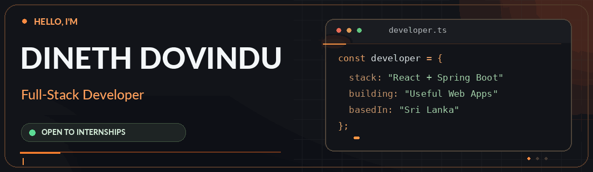
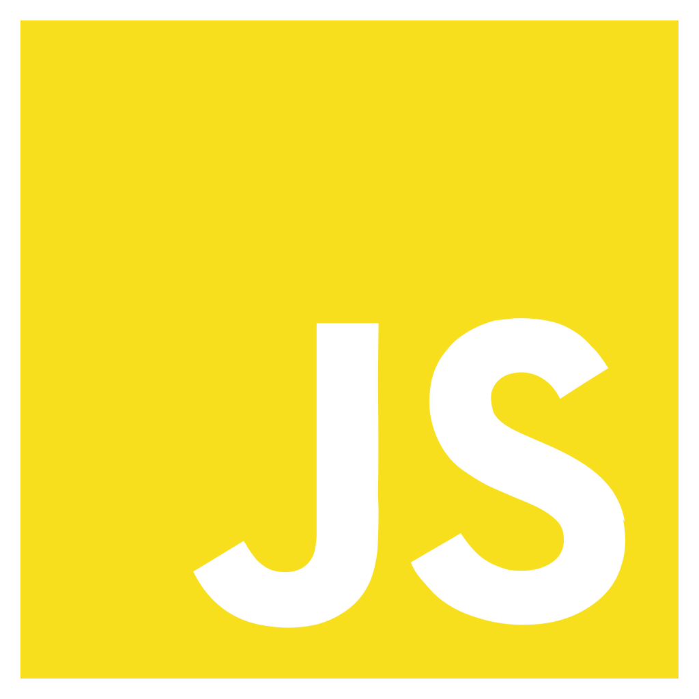
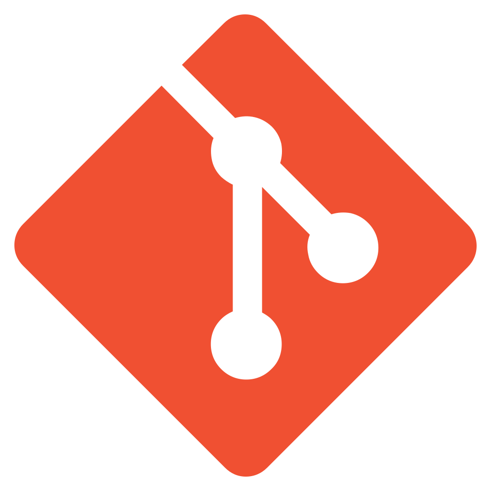
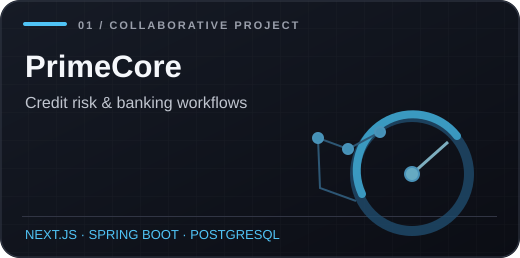
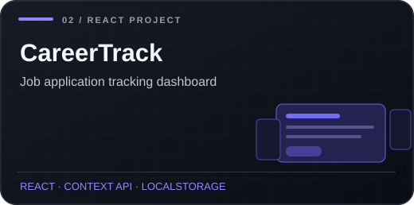
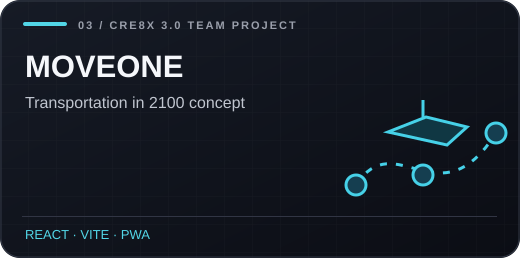
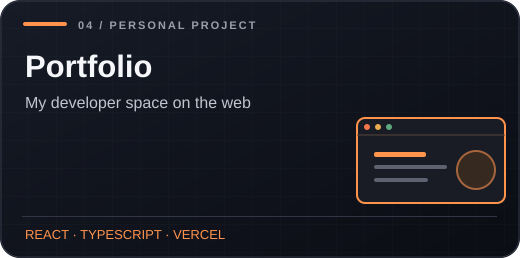

<!-- Dineth Dovindu | GitHub Profile README -->
<p align="center">
  <a href="https://kdinethdovindu.is-a.dev" title="Explore my portfolio">
    
  </a>
</p>

<p align="center">
  <a href="https://kdinethdovindu.is-a.dev"></a>&nbsp;
  <a href="https://www.linkedin.com/in/dineth-dovindu-ba801a383/"></a>&nbsp;
  <a href="mailto:kdinethdovindu@gmail.com"></a>
</p>

### 👨‍💻 About Me

I'm **Dineth Dovindu**, a **BSc (Hons) Information Technology & Management undergraduate** at the **University of Moratuwa, Sri Lanka**. I enjoy turning ideas into practical, user-friendly web applications — from polished React interfaces to secure Spring Boot APIs.

- 🎯 **Open to Full-Stack Development and Software Engineering internships**
- 🧩 **Main focus:** React, Next.js, TypeScript, Java, Spring Boot and PostgreSQL
- 🔐 **Interested in:** REST APIs, authentication, backend architecture and responsive UI
- 🚀 **Currently exploring:** Docker, deployment and DevOps practices
- 🤝 **Enjoy:** Learning by building, collaborative development and solving real problems

### 🧰 Tech Stack

<h4>🖥️ Frontend &amp; Web</h4>
<p align="center">
  <span title="React" aria-label="React" style="display:inline-block; margin:6px; padding:10px; border:1px solid #303743; border-radius:12px; background:#24272e;"></span>
  <span title="TypeScript" aria-label="TypeScript" style="display:inline-block; margin:6px; padding:10px; border:1px solid #303743; border-radius:12px; background:#24272e;"></span>
  <span title="JavaScript" aria-label="JavaScript" style="display:inline-block; margin:6px; padding:10px; border:1px solid #303743; border-radius:12px; background:#24272e;"></span>
  <span title="HTML5" aria-label="HTML5" style="display:inline-block; margin:6px; padding:10px; border:1px solid #303743; border-radius:12px; background:#24272e;"></span>
  <span title="CSS3" aria-label="CSS3" style="display:inline-block; margin:6px; padding:10px; border:1px solid #303743; border-radius:12px; background:#24272e;"></span>
  <span title="Tailwind CSS" aria-label="Tailwind CSS" style="display:inline-block; margin:6px; padding:10px; border:1px solid #303743; border-radius:12px; background:#24272e;"></span>
  <span title="Next.js" aria-label="Next.js" style="display:inline-block; margin:6px; padding:10px; border:1px solid #303743; border-radius:12px; background:#24272e;"></span>
</p>

<h4>⚙️ Backend &amp; APIs</h4>
<p align="center">
  <span title="Java" aria-label="Java" style="display:inline-block; margin:6px; padding:10px; border:1px solid #303743; border-radius:12px; background:#24272e;"></span>
  <span title="Spring Boot" aria-label="Spring Boot" style="display:inline-block; margin:6px; padding:10px; border:1px solid #303743; border-radius:12px; background:#24272e;"></span>
  <span title="Spring Security" aria-label="Spring Security" style="display:inline-block; margin:6px; padding:10px; border:1px solid #303743; border-radius:12px; background:#24272e;"></span>
  <span title="Spring Data JPA" aria-label="Spring Data JPA" style="display:inline-block; margin:6px; padding:12px 9px; border:1px solid #303743; border-radius:12px; background:#24272e; color:#e9edf2; font-size:16px; font-weight:700;">JPA</span>
  <span title="REST APIs" aria-label="REST APIs" style="display:inline-block; margin:6px; padding:12px 9px; border:1px solid #303743; border-radius:12px; background:#24272e; color:#e9edf2; font-size:16px; font-weight:700;">API</span>
  <span title="JWT" aria-label="JWT" style="display:inline-block; margin:6px; padding:10px; border:1px solid #303743; border-radius:12px; background:#24272e;"></span>
  <span title="PHP" aria-label="PHP" style="display:inline-block; margin:6px; padding:10px; border:1px solid #303743; border-radius:12px; background:#24272e;"></span>
  <span title="Python" aria-label="Python" style="display:inline-block; margin:6px; padding:10px; border:1px solid #303743; border-radius:12px; background:#24272e;"></span>
  <span title="Flask" aria-label="Flask" style="display:inline-block; margin:6px; padding:10px; border:1px solid #303743; border-radius:12px; background:#24272e;"></span>
</p>

<h4>🗄️ Databases</h4>
<p align="center">
  <span title="PostgreSQL" aria-label="PostgreSQL" style="display:inline-block; margin:6px; padding:10px; border:1px solid #303743; border-radius:12px; background:#24272e;"></span>
  <span title="MySQL" aria-label="MySQL" style="display:inline-block; margin:6px; padding:10px; border:1px solid #303743; border-radius:12px; background:#24272e;"></span>
  <span title="MongoDB" aria-label="MongoDB" style="display:inline-block; margin:6px; padding:10px; border:1px solid #303743; border-radius:12px; background:#24272e;"></span>
</p>

<h4>🛠️ Tools &amp; Platforms</h4>
<p align="center">
  <span title="Git" aria-label="Git" style="display:inline-block; margin:6px; padding:10px; border:1px solid #303743; border-radius:12px; background:#24272e;"></span>
  <span title="GitHub" aria-label="GitHub" style="display:inline-block; margin:6px; padding:10px; border:1px solid #303743; border-radius:12px; background:#24272e;"></span>
  <span title="Postman" aria-label="Postman" style="display:inline-block; margin:6px; padding:10px; border:1px solid #303743; border-radius:12px; background:#24272e;"></span>
  <span title="JUnit" aria-label="JUnit" style="display:inline-block; margin:6px; padding:10px; border:1px solid #303743; border-radius:12px; background:#24272e;"></span>
  <span title="Mockito" aria-label="Mockito" style="display:inline-block; margin:6px; padding:12px 9px; border:1px solid #303743; border-radius:12px; background:#24272e; color:#e9edf2; font-size:15px; font-weight:700;">MOCK</span>
  <span title="Swagger / OpenAPI" aria-label="Swagger / OpenAPI" style="display:inline-block; margin:6px; padding:10px; border:1px solid #303743; border-radius:12px; background:#24272e;"></span>
  <span title="Vercel" aria-label="Vercel" style="display:inline-block; margin:6px; padding:10px; border:1px solid #303743; border-radius:12px; background:#24272e;"></span>
  <span title="Figma" aria-label="Figma" style="display:inline-block; margin:6px; padding:10px; border:1px solid #303743; border-radius:12px; background:#24272e;"></span>
  <span title="Docker (learning)" aria-label="Docker, learning" style="display:inline-block; margin:6px; padding:10px; border:1px solid #303743; border-radius:12px; background:#24272e;"></span>
</p>

### 🚀 Featured Projects

<table>
  <tr>
    <td width="50%" valign="top">
      <a href="https://github.com/Metaminds-BankWebApp/bank-web-app-frontend"></a>
      <br />
      <b>PrimeCore — Credit Risk Platform</b><br />
      A team-built banking and credit-assessment application featuring credit insights, customer workflows and officer-facing tools. <i>Team leader &amp; full-stack contributor.</i>
      <br /><br />
      <a href="https://github.com/Metaminds-BankWebApp/bank-web-app-frontend">Source Code</a> · <a href="https://bank-web-app-theta.vercel.app">Live Demo</a>
    </td>
    <td width="50%" valign="top">
      <a href="https://github.com/kdinethdovindu/React-job-tracker"></a>
      <br />
      <b>CareerTrack — Job Application Tracker</b><br />
      A React application for managing applications, tracking statuses, searching and filtering opportunities, and persisting data with localStorage.
      <br /><br />
      <a href="https://github.com/kdinethdovindu/React-job-tracker">Source Code</a> · <a href="https://react-job-tracker-henna.vercel.app/">Live Demo</a>
    </td>
  </tr>
  <tr>
    <td width="50%" valign="top">
      <a href="https://github.com/PixelCraft-Cre8X/transport-2100"></a>
      <br />
      <b>MOVEONE — Transportation in 2100</b><br />
      A collaborative Cre8X 3.0 concept featuring multimodal journey planning, a simulated booking flow and a PWA experience. <i>UI, PWA &amp; deployment contributor.</i>
      <br /><br />
      <a href="https://github.com/PixelCraft-Cre8X/transport-2100">Source Code</a> · <a href="https://transport-2100-ashy.vercel.app/">Live Demo</a>
    </td>
    <td width="50%" valign="top">
      <a href="https://github.com/kdinethdovindu/Portfolio"></a>
      <br />
      <b>Personal Portfolio — This Website</b><br />
      My responsive React and TypeScript portfolio with interactive motion, project showcases, certifications and a dedicated contact section.
      <br /><br />
      <a href="https://github.com/kdinethdovindu/Portfolio">Source Code</a> · <a href="https://kdinethdovindu.is-a.dev/">Live Website</a>
    </td>
  </tr>
</table>

### 📍 Currently

```text
Learning       → Docker, DevOps & modern deployment workflows
Building       → Full-stack apps with React + Spring Boot
Looking for    → Software Engineering / Full-Stack internships
Based in       → Sri Lanka
```

### 🤝 Let's Connect

I'm always interested in collaborating on practical projects and learning from other developers. If you'd like to talk about an internship, a project or an idea, feel free to reach out.

<p align="center">
  <a href="https://kdinethdovindu.is-a.dev">🌐 Portfolio</a>&nbsp; • &nbsp;
  <a href="https://www.linkedin.com/in/dineth-dovindu-ba801a383/">💼 LinkedIn</a>&nbsp; • &nbsp;
  <a href="mailto:kdinethdovindu@gmail.com">✉️ Email</a>&nbsp; • &nbsp;
  <a href="https://github.com/kdinethdovindu?tab=repositories">⌨️ Repositories</a>
</p>

<p align="center"><sub>Designed with care · Built to keep learning</sub></p>
